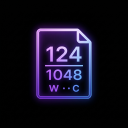

# Live Characters & Words Count 📝

<div align="center">
  
</div>

<p align="center">
  <b>A minimalist, high-performance extension for Visual Studio Code and Google Antigravity IDE that tracks your document's word and character count in real time.</b>
</p>

<div align="center">

  [](https://marketplace.visualstudio.com/items?itemName=Winstead-Inc.live-characters-and-words-count)
  [](LICENSE.md)

</div>

---

## ✨ Features

- **Real-Time Tracking:** Instantly updates the word and character count as you type. 
- **Native UI Integration:** Injected directly into the status bar of VS Code or Antigravity IDE. It stays completely out of your main coding space.
- **Zero Performance Impact:** Built on modern extensibility APIs. The background calculation never blocks your typing or slows down your IDE.
- **Works Everywhere:** Automatically tracks counts across all file types effortlessly.

## 🚀 Installation

### Option 1: VS Code Marketplace (Recommended)
1. Open Visual Studio Code.
2. Go to the **Extensions** view (`Ctrl+Shift+X` or `Cmd+Shift+X`).
3. Search for **Live Characters & Words Count**.
4. Click **Install**, and you're good to go!

Alternatively, download it directly from the [VS Code Marketplace](https://marketplace.visualstudio.com/items?itemName=Winstead-Inc.live-characters-and-words-count).

### Option 2: Manual Installation (VS Code & Antigravity IDE)
1. Go to the [Releases](https://github.com/FranciscoJRFreitas/words-and-chars-count/releases) tab.
2. Download the latest `.vsix` file.
3. **VS Code:** Open the Extensions view, click the `...` menu, and select **Install from VSIX...**.
4. **Antigravity IDE:** The VSIX extension is fully compatible and can be installed via the IDE's extension manager.

## 🛠️ How it Works

Simply open any text, markdown, or code file in Visual Studio Code or Antigravity IDE. Look at the bottom status bar to see a live updating counter.

The extension taps into VS Code's editor events to efficiently recalculate the counts dynamically without locking up your thread.

## ⚙️ Building from Source

To build this extension locally, you will need:
- **Node.js** and **npm**
- **Visual Studio Code**

1. Clone this repository:
   ```bash
   git clone https://github.com/FranciscoJRFreitas/words-and-chars-count.git
   ```
2. Open the project in VS Code.
3. Install dependencies:
   ```bash
   npm install
   ```
4. Compile the extension:
   ```bash
   npm run compile
   ```
5. Press `F5` to open a new Extension Development Host window with the extension loaded.

## 👏 Credits

This extension is based on the original work by **Oliver Kovacs**, adapted to include a character count.  
The original project was licensed under the **MIT License**, allowing modifications and redistribution.

## 📜 License

This project is licensed under the **GNU General Public License v3.0 (GPL-3.0)** - see the [LICENSE.md](LICENSE.md) file for details.

---
*Created by Winstead-Inc.*
